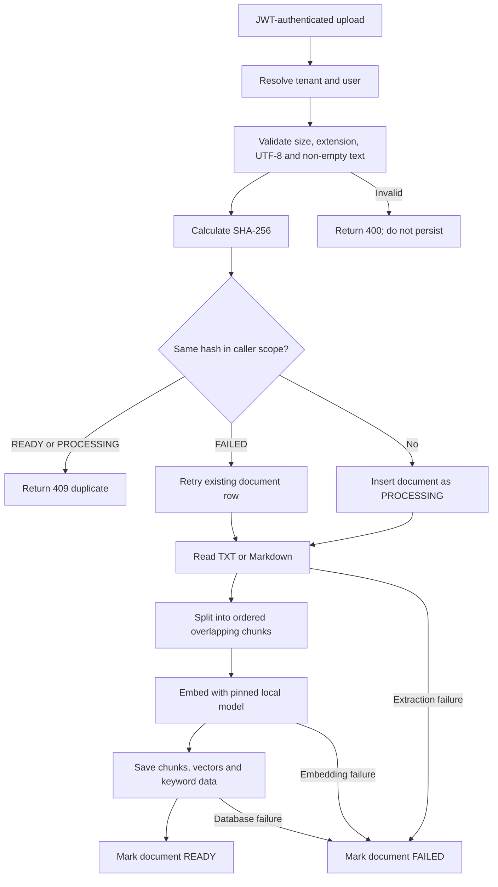
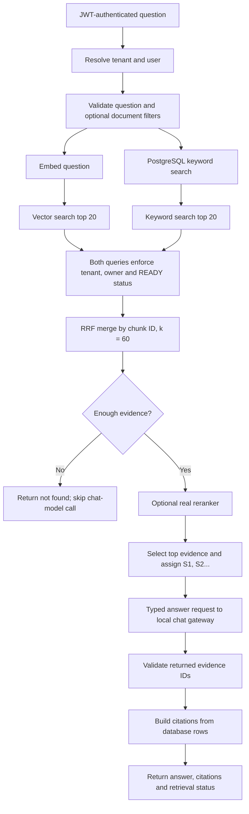

# Productivity OS — Document Q&A (RAG)

**Week:** 3  
**Status:** Implementation contract  
**Goal:** Upload text documents, retrieve relevant evidence with keyword and vector search, and return answers with verifiable citations.

## 1. Scope

### Build this week

- Upload `.txt` and `.md` documents synchronously.
- Chunk and embed documents locally; store chunks in PostgreSQL with pgvector.
- Search with PostgreSQL full-text search and vector similarity.
- Combine ranked results with Reciprocal Rank Fusion (RRF).
- Answer using retrieved evidence and the existing local chat-model gateway.
- Return citations the server can verify against stored chunks.
- Test ownership isolation, retrieval quality, failures, and citation validity.

### Out of scope

- PDF or Word parsing.
- Background ingestion queues.
- HNSW or other approximate vector indexes.
- Per-tenant JWT claims.
- Streaming responses.
- A trained reranker.

Reranking is a stretch goal after hybrid search and evaluation work. An interface alone does not count as an implemented reranker.

## 2. Core decisions

1. **Use local models.** Embeddings use a pinned Ollama model; answer generation uses the existing local chat-model gateway. No paid OpenAI dependency.
2. **Keep embedding configuration stable.** Existing vectors can only be compared with vectors made by the same embedding model and configuration. Do not silently change embedding models for existing documents.
3. **Use PostgreSQL for both retrieval methods.** pgvector handles semantic search; PostgreSQL full-text search handles keyword matching.
4. **Fuse ranks, not raw scores.** Vector distance and keyword scores are on different scales.
5. **Enforce ownership in database queries.** A document ID from a request is a filter, never proof of access.
6. **Build citations on the server.** The model may refer to supplied evidence IDs; the backend resolves them to stored metadata.
7. **Start with exact vector search.** Add a vector index only if measurements justify it.

LangChain4j describes RAG as indexing plus retrieval. Its current built-in full-text/hybrid integrations focus on Azure AI Search and Elasticsearch; implementing PostgreSQL queries and RRF explicitly is a deliberate choice for this project. [LangChain4j RAG guide](https://docs.langchain4j.dev/tutorials/rag/)

## 3. Ingestion flow



### Ingestion rules

- Initially accept only `.txt` and `.md`.
- Reject empty files, invalid UTF-8, unsupported types, and files over the configured limit.
- Calculate SHA-256 from the original uploaded bytes.
- Use a paragraph-aware chunker. Start at approximately **800 characters per chunk with 100 characters of overlap**; tune only after evaluation.
- Pin the exact Ollama embedding-model tag.
- Verify the model’s returned vector length in a smoke test **before** selecting the database vector-column dimension.
- Store the model tag on each document.
- Do not keep a database transaction open while calling Ollama. Save processing status, perform the model work, then persist results and update status.
- If embedding fails, retain a `FAILED` document row with a safe error category. Never store credentials, stack traces, or document contents in `failure_reason`.

Ollama provides local embedding models including `nomic-embed-text`; verify the exact selected tag and output dimension during implementation. [Ollama model page](https://ollama.com/library/nomic-embed-text)

### Duplicate and retry behavior

The duplicate key is `(tenant_id, owner_user_id, content_hash)`.

- Existing `READY`: return `409`.
- Existing `PROCESSING`: return `409` or its current status.
- Existing `FAILED`: retry the same row. Delete any partial chunks, set status to `PROCESSING`, and retry ingestion.
- New hash: insert a new row as `PROCESSING`.

## 4. Question and answer flow



### Retrieval rules

- Run vector and keyword retrieval against the same caller scope.
- Each method returns up to 20 candidate chunks.
- An optional `documentIds` filter may only narrow the caller’s own document set.
- Merge duplicate chunks by chunk ID using:

  `RRF(chunk) = Σ 1 / (60 + rank)`

  Ranks start at 1. If a chunk appears in both lists, add both contributions.
- Return the top `topK` results after fusion. Validate `topK` and impose a server-side maximum.
- If a hybrid query cannot embed because Ollama is unavailable, it may continue with keyword results and return `retrievalDegraded: true`. Vector-only search returns `503`.
- If no evidence passes the configured retrieval threshold, return an honest not-found response and do not call the chat model.
- Send the chat model numbered evidence such as `[S1]` and `[S2]`. Document text is untrusted evidence—not instructions to follow.
- The model’s `sufficient` field is not trusted by itself. The backend decides whether evidence exists and validates all source IDs.
- A citation proves that the cited chunk exists and was retrieved. It does **not** prove the answer faithfully represents it; evaluate answer correctness separately.

## 5. Proposed schema

This is the design for a future Flyway migration. Confirm the next available migration version, table names, and user ID type against the project before implementing it.

```sql
CREATE EXTENSION IF NOT EXISTS vector;

CREATE TABLE rag_document (
    id BIGSERIAL PRIMARY KEY,
    tenant_id VARCHAR(36) NOT NULL DEFAULT 'default-tenant',
    owner_user_id INTEGER NOT NULL REFERENCES users(id),
    filename VARCHAR(255) NOT NULL,
    content_type VARCHAR(100) NOT NULL,
    content_hash CHAR(64) NOT NULL,
    status VARCHAR(20) NOT NULL
        CHECK (status IN ('PROCESSING', 'READY', 'FAILED')),
    failure_reason VARCHAR(100),
    chunk_count INTEGER NOT NULL DEFAULT 0,
    embedding_model VARCHAR(100) NOT NULL,
    created_at TIMESTAMPTZ NOT NULL DEFAULT CURRENT_TIMESTAMP,
    updated_at TIMESTAMPTZ NOT NULL DEFAULT CURRENT_TIMESTAMP,
    CONSTRAINT uk_rag_document_scope_hash
        UNIQUE (tenant_id, owner_user_id, content_hash)
);

CREATE TABLE rag_chunk (
    id BIGSERIAL PRIMARY KEY,
    document_id BIGINT NOT NULL
        REFERENCES rag_document(id) ON DELETE CASCADE,
    chunk_index INTEGER NOT NULL,
    content TEXT NOT NULL,
    embedding vector(768) NOT NULL,
    content_tsv TSVECTOR GENERATED ALWAYS AS
        (to_tsvector('english'::regconfig, content)) STORED,
    CONSTRAINT uk_rag_chunk_position UNIQUE (document_id, chunk_index)
);

CREATE INDEX idx_rag_document_scope_status
    ON rag_document (tenant_id, owner_user_id, status);

CREATE INDEX idx_rag_chunk_content_tsv
    ON rag_chunk USING GIN (content_tsv);
```

**Do not ship `vector(768)` without verifying it.** Confirm the selected embedding model returns 768 values in a smoke test; if not, change the schema dimension to match.

Scope is stored on `rag_document`. Retrieval joins chunks to their document and filters there, avoiding duplicated owner and tenant columns drifting out of sync. `ON DELETE CASCADE` deletes a document’s chunks with it.

The generated `tsvector` keeps keyword-search data synchronized with chunk text. [PostgreSQL text-search tables](https://www.postgresql.org/docs/16/textsearch-tables.html)

## 6. API contract

All endpoints require JWT authentication. The authenticated principal determines user and tenant scope.

| Method | Path | Purpose |
|---|---|---|
| `POST` | `/api/rag/documents` | Upload one multipart `.txt` or `.md` file |
| `GET` | `/api/rag/documents` | List only the caller’s documents |
| `GET` | `/api/rag/documents/{id}` | Get an owned document’s status |
| `GET` | `/api/rag/documents/{id}/chunks` | Inspect the caller’s chunks; never return raw vectors |
| `DELETE` | `/api/rag/documents/{id}` | Delete an owned document and its chunks |
| `POST` | `/api/rag/search` | Inspect retrieval results for development/evaluation |
| `POST` | `/api/rag/ask` | Ask a question and receive a cited answer |

### Search request

```json
{
  "query": "refund window",
  "mode": "HYBRID",
  "topK": 5,
  "documentIds": [12]
}
```

`mode` is `VECTOR`, `KEYWORD`, or `HYBRID`. Search results may include ranks and scores for evaluation, but must not expose raw embeddings.

### Ask request

```json
{
  "question": "How long do I have to request a refund?",
  "topK": 5
}
```

### Ask response

```json
{
  "answer": "The policy allows 30 days. [S1]",
  "sufficient": true,
  "citations": [
    {
      "sourceId": "S1",
      "documentId": 12,
      "filename": "refund-policy.txt",
      "chunkId": 41,
      "chunkIndex": 0,
      "excerpt": "Refund requests must be submitted within 30 days..."
    }
  ],
  "retrievalDegraded": false
}
```

The backend constructs citation fields from stored document and chunk rows after validating that the returned `sourceId` maps to evidence supplied to the model.

### Error behavior

| Situation | Response |
|---|---|
| Invalid, empty, unsupported, or oversized upload | `400` or `413`; no searchable chunks |
| Duplicate upload already `READY` or `PROCESSING` | `409` |
| Document absent or not owned by caller | `404` |
| Embedding service unavailable during upload | Mark `FAILED`; return `503` |
| Hybrid query embedding unavailable | Continue keyword-only; set `retrievalDegraded: true` |
| Vector-only query embedding unavailable | `503` |
| No usable evidence | Honest not-found response; no model call |
| Chat gateway unavailable or invalid answer structure | `502` or `503`; no fabricated citations |

## 7. Implementation package map

Adapt names to the current project; don’t reorganize unrelated packages just to match this diagram.

```text
ai/
├── document/
│   ├── DocumentController
│   ├── DocumentService
│   ├── DocumentIngestionService
│   ├── DocumentParser
│   └── DocumentRepository
├── chunking/
│   └── DocumentChunker
├── embedding/
│   └── EmbeddingService
├── retrieval/
│   ├── ChunkRepository
│   ├── VectorSearchService
│   ├── KeywordSearchService
│   ├── HybridSearchService
│   └── ReciprocalRankFusion
├── rag/
│   ├── RagController
│   ├── RagService
│   ├── RagAssistant
│   ├── RagAnswer
│   └── CitationService
├── security/
│   └── RagScope
└── evaluation/
    └── RetrievalMetrics
```

`DocumentChunker` and `ReciprocalRankFusion` should be deterministic units that can be tested without Spring, PostgreSQL, or a model. `RagScope` should come from the authenticated principal, never request JSON.

## 8. Isolation and prompt-safety rules

1. Every chunk search joins `rag_document` and filters by tenant, owner, and `READY`.
2. A document ID from a request only narrows the already-authorized result set.
3. Return `404`, not `403`, for another user’s document to avoid revealing its existence.
4. Test two users in the same tenant, not just two tenants.
5. The default tenant is scaffolding. Do not claim full tenant isolation until tenant claims are implemented.
6. Treat uploaded text as untrusted evidence. Delimit it in the answer prompt and instruct the model not to follow commands inside it.
7. This RAG path does not execute tools or call arbitrary URLs.
8. Validate model-returned evidence IDs against the exact evidence supplied to that call.

## 9. Evaluation and tests

Create four small fixture documents and about eight questions. Record expected relevant chunk IDs for each question. Run the same set against `VECTOR`, `KEYWORD`, and `HYBRID`.

Report:

- **Precision@3:** relevant chunks among the top three divided by three.
- **Recall@3:** relevant chunks among the top three divided by all known relevant chunks.
- **MRR:** mean reciprocal rank of the first relevant result.
- **Citation validity:** citations resolve to returned, caller-owned chunks.
- **Answer correctness:** manually checked against the fixture evidence.
- **Latency:** retrieval and end-to-end answer time.

### Required tests before calling Week 3 done

- Chunk order and overlap are deterministic.
- Embedding output dimension is checked against the configured schema dimension.
- RRF merges duplicate chunk IDs and gives the expected ranking.
- Vector, keyword, and hybrid queries all enforce the same scope.
- A user cannot search, inspect, or delete another user’s document.
- Failed ingestion can retry without stale chunks.
- A model-invented source ID is rejected.
- Empty retrieval does not call the chat model.
- Evaluation produces a comparison for all three retrieval modes.

## 10. Build order

1. **Chunking and embedding smoke test:** prove the local model runs and verify its output dimension.
2. **Schema and ingestion:** add the next Flyway migration, parse `.txt`/`.md`, and test document status transitions.
3. **Vector retrieval:** implement scoped exact vector search.
4. **Keyword retrieval:** implement scoped PostgreSQL full-text search.
5. **Hybrid retrieval:** add RRF and test it independently.
6. **Cited answers:** connect retrieved evidence to the local chat gateway and validate citations.
7. **Evaluation and hardening:** run retrieval, isolation, and failure tests. Add a real reranker only if there is time to implement and measure one.